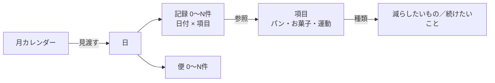
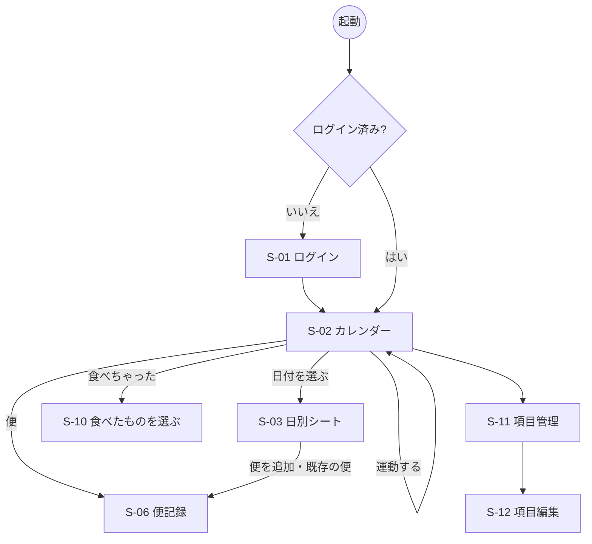

# Structure：ひびログ

> Garrett「UXの5段階」の Structure レイヤー（情報をどう組織し、操作がどう流れるか）を定義する文書。
> 前提資料：[01-strategy.md](01-strategy.md)、[02-scope.md](02-scope.md)
> 画面内の配置や部品の選定は Skeleton、色やアイコンの表現は Surface で扱う。
>
> - 状態：第2版（2026-11-26）。Scope 第2版に合わせ、食事記録の画面をなくし、月カレンダーを起点に「食べちゃった」「運動する」「便」を記録する構成にした。デモモードの試作（`/proto`、`src/demo/proto/`）で見え方を確かめた内容を反映している。初版からの変更は 10章。
> - 記法：末尾の `→Q番号` は 9章の判断事項に対応する。`F-xx` は Scope の機能IDを指す。画面IDは初版から引き継ぎ、廃止した画面の番号は欠番とする。

---

## 1. 構造の方針

| 方針 | 内容 | 根拠 |
|---|---|---|
| 月カレンダーを起点にする | 起動直後の画面を月カレンダーとし、すべての操作をここから始める | Scope F-10 |
| 数字を最初に見せる | 開いた瞬間に、今月食べた日数と運動の連続日数が目に入る位置に置く | Strategy 3章「食べたくなったとき」 |
| 記録は画面を移らずに終える | 食べたもの・運動の記録は、カレンダーの上で完結させる。便だけは初版の記録画面を使う | Scope 4章（2タップ以内） |
| 押し間違いはその場で直せる | 記録・取り消しのたびに、元に戻せる知らせを出す | Scope Q53 |
| 階層を浅くする | 日別の確認はカレンダーの上のシートで行う。画面を移るのは便の記録と項目の管理だけ | Strategy 原則6 |

---

## 2. 概念モデル

- **日**：振り返りの単位。端末の暦日（0時）で区切る。
- **記録**：「その日にその項目が起きた」の1件。同じ日の同じ項目は1件（Scope Q51）。編集はなく、押すか取り消すかのみ。
- **便**：初版と同じ。1日に何件でも記録でき、編集・削除できる。
- **項目**：減らしたいもの（初期：パン、お菓子）と続けたいこと（初期：運動）の中身。
- **起点日**：食べなかった日を数え始める日（Scope Q52）。利用者が直接触る情報ではない。

---

## 3. 情報の組織化

### 上部の数字

表示中の月によらず、今日の時点の数字を示す（→Q65）。

| カード | 主役 | 添える情報 |
|---|---|---|
| 減らしたいもの（見出しは項目名を「・」でつなぐ。例：パン・お菓子） | 今月食べた日数 | 先月の同じ日まで（例：先月26日まで 12日）、食べずに続いた日数とベスト（例：食べずに 2日・ベスト 10日） |
| 続けたいこと（見出しは項目名。例：運動） | 連続日数 | ベスト、今月やった日数 |

### 月カレンダーの1日分の情報

| 順序 | 情報 | まとめ方 |
|---|---|---|
| 1 | 日付、今日かどうか | |
| 2 | 続けたいことの印 | やった項目ごとに1つ。日付と同じ段に置く |
| 3 | 減らしたいものの印 | 食べた項目ごとに1つ。項目の並び順 |
| 4 | 便 | 排便1回につき1つ、形状がわかる形で示す。3つまで示し、4回以上は残りを「+n」とする →Q67 |
| 5 | 食べなかった日かどうか | マス全体の塗りで示す。起点日以降の過去の日だけ。今日は「途中」として塗らない →Q66 |

### 日別シートの並び

1. 項目（減らしたいもの → 続けたいことの順。押した項目は選択状態）
2. 便（時刻順）
3. 便を追加

### 項目の並び

減らしたいもの → 続けたいことの順。種類の中では、追加した順（並び順）とする。使用頻度による並び替えはしない。

---

## 4. 画面一覧

| ID | 画面 | 形 | 役割 | 機能 |
|---|---|---|---|---|
| S-01 | ログイン | 画面 | 本人であることを確認する | F-07 |
| S-02 | カレンダー | 画面 | 起点。月の表示、数字、記録の開始 | F-10, F-14 |
| S-03 | 日別 | S-02 の上のシート | 1日分の確認、その日の記録・取り消し | F-05, F-06 |
| S-06 | 便記録 | 画面 | 便の新規作成、編集、削除 | F-03, F-06 |
| S-10 | 食べたものを選ぶ | S-02 の上のシート | 今日食べた項目を選ぶ | F-12 |
| S-11 | 項目管理 | 画面 | 項目の一覧と追加 | F-15 |
| S-12 | 項目編集 | 画面 | 名称、略称、「使わない」の変更 | F-15 |

F-08（スマホ向けPWA）は全画面に共通する前提であり、専用の画面はない。F-16（初版の食事記録の引き継ぎ）は画面を持たず、起動時に自動で行う（→Q68）。

廃止：S-04 食事記録、S-07 カテゴリ管理、S-08 カテゴリ編集、S-09 集計。S-05 は初版から欠番。S-03 は画面からシートに変えた（→Q62）。

---

## 5. 画面遷移

### 戻り先のルール

| 操作 | 戻り先 |
|---|---|
| S-10 で項目を選ぶ、閉じる | S-02 |
| S-03 を閉じる | S-02（表示していた月を保持） |
| S-06 で保存、キャンセル、削除 | 開始した画面。S-03 から開いた場合も S-02 に戻り、シートは閉じた状態とする →Q62 |
| S-12 で保存、キャンセル | S-11 |
| S-11 から戻る | S-02 |

S-02 を開いたときは、今日を含む月を示す。

---

## 6. 主要な操作フロー

タップ数はアプリを開いた状態から記録までの回数。

| タスク | 手順 | タップ数 |
|---|---|---|
| 何も起きなかった日 | なし | 0 |
| 食べたものを記録 | 食べちゃった → 項目 | 2（項目を選んだ時点で記録する）→Q64 |
| 運動を記録 | 運動する | 1（項目が1つのとき）→Q63 |
| 便を記録 | 便 → 形状を選ぶ → 保存 | 3（初版と同じ。量や排便感を入れる場合は各+1）→Q17 |
| 押し間違いを直す | 知らせの「取り消す」 | 1 |
| 過去の日に記録・取り消し | 日付を選ぶ → 項目 | 2 |
| 今月の様子を見る | カレンダーを見る | 0 |

別の月の日の操作は、表示の移動分のタップが加わる。

---

## 7. 画面ごとの振る舞い

### 記録の共通ルール

| 項目 | 振る舞い |
|---|---|
| 対象の日 | S-02 の記録ボタンは、押した時点の今日。S-03 からはその日 |
| 記録の確定 | 食べたもの・運動は、押した時点で記録する。保存の操作はない |
| 取り消し | 押した項目をもう一度押すと取り消す。確認は求めない（Scope Q53） |
| 知らせ | 記録・取り消しのたびに、内容と「取り消す」（取り消したときは「元に戻す」）を約4秒示す。押すと直前の操作を逆にする →Q69 |
| 未来の日 | 記録できない。カレンダーでは表示するが、選択できない →Q19 |
| 「使わない」項目 | 選択肢に出ない。過去の記録はカレンダーと日別シートに残り、数字にも数える（Scope Q58） |

### S-02 カレンダー

| 項目 | 振る舞い |
|---|---|
| 表示 | 月のみ。週表示はない（Scope Q56）。週の開始は月曜 |
| 期間の移動 | 前後の月に移動できる。矢印、左右に払う操作、「今日」で移る（初版と同じ） |
| 数字 | 上部に2枚のカードで示す（3章）。表示中の月を変えても、今日の時点の数字のまま |
| 記録の開始 | 下部に「食べちゃった」「運動する」「便」の3つ →Q63 |
| 運動のボタン | 今日まだなら「運動する」。押すと記録し、「運動した」（選択状態）に変わる。もう一度押すと取り消す。続けたいことの項目が2つ以上なら、押すと項目を選ぶシートを開く |
| 項目管理 | 頻度が低いため、記録の開始より目立たない経路（ヘッダー右）にする |

### S-10 食べたものを選ぶ

| 項目 | 振る舞い |
|---|---|
| 選択肢 | 減らしたいものの「使う」項目 |
| 選ぶ | その項目を今日の記録にして、シートを閉じる |
| すでに今日記録した項目 | 選択状態で示す。押すと取り消して、シートを閉じる |
| 閉じる | 「閉じる」、背後の幕、Esc で閉じる。何も記録しない |

### S-03 日別シート

| 項目 | 振る舞い |
|---|---|
| 見出し | 日付（例：11月26日（木）） |
| 項目 | 減らしたいもの・続けたいことの「使う」項目と、その日に記録がある「使わない」項目を並べる。押した項目は選択状態。押すたびに記録と取り消しを切り替え、シートは開いたまま |
| 便 | その日の便を時刻順に並べる。行を押すと S-06 の編集に進む |
| 便を追加 | S-06 の新規に進む。日付はその日、時刻は操作時の時分（Scope Q5） |
| 未同期 | 未同期の記録には、そのことを示す（初版の日別詳細と同じ） |

### S-06 便記録

初版と同じ。日付と時刻は編集時のみ示し、修正できる（Scope Q5）。

### S-11 項目管理・S-12 項目編集

| 項目 | 振る舞い |
|---|---|
| 一覧の構成 | 種類ごと（減らしたいもの、続けたいこと）に示す。「使わない」項目は使用中のものと区別する |
| 追加 | 種類ごとに追加できる。「使う」項目が4つに達した種類では追加できない（Scope Q57） |
| 追加・編集の入力 | 名称（10文字以内）、略称（1文字。追加時は名称の先頭1文字を自動で入れる）。編集時は「使う／使わない」も |
| 入力の制約 | 空の名称と、同じ種類の中での重複した名称は保存できない |
| 注意の表示 | 名称の変更は過去の記録にも反映されることを、編集時に示す |
| 種類 | 項目の種類（減らしたいもの／続けたいこと）は、追加した後に変えられない →Q70 |

### 初版の食事記録の引き継ぎ（F-16）

| 項目 | 振る舞い |
|---|---|
| いつ | 第2版で初めて起動したとき、自動で1回だけ行う。確認は求めない →Q68 |
| 知らせ | 引き継いだ日数を知らせる（例：これまでの記録から 18日分を引き継ぎました）。引き継ぐ記録がなければ何も示さない |
| 起点日 | 初版の食事記録の最初の日。初版の記録がなければ、第2版で初めて起動した日 |
| 失敗 | 通信できないなどで引き継げなかったときは、次の起動で再び試す |

---

## 8. 共通の状態とラベル

### システムの状態

| 状態 | 振る舞い |
|---|---|
| 読み込み中 | 読み込み中であることがわかるようにする。数字は読み込みが終わるまで示さない |
| カレンダー、日別シートの読み込み失敗 | 再試行できるようにする |
| 記録の失敗 | 同期のときにサーバーに拒否された記録は取り消し、同期できなかったことを伝える（初版と同じ） |
| オフライン | 記録を端末に保存し、通常どおり画面と数字に反映する。オフラインであることと、未同期の記録があることを示す（Scope Q14） |
| ログインの期限切れ | S-01 を表示し、ログイン後は S-02 に戻る |

### 記録がないときの表現

押していない日は、減らしたいものは「食べなかった日」、続けたいことは「やっていない日」とみなす（Strategy Q44）。ただし、食べなかった日は塗りで示すだけで、「食べなかった」などの文字は各マスに出さない。起点日より前の日は、どちらともみなさない。

### ラベル

| 対象 | ラベル | 備考 |
|---|---|---|
| 記録の開始 | 食べちゃった、運動する（記録後は 運動した）、便 | 運動のラベルは続けたいことの項目名から作る |
| 食べたものを選ぶシートの見出し | 何を食べた？ | |
| 減らしたいものの数字 | 今月食べた、先月26日まで、食べずに、ベスト | Scope Q60、Q61 |
| 続けたいことの数字 | 連続、ベスト、今月 | |
| 知らせ | 〇〇を記録しました／〇〇を取り消しました、取り消す／元に戻す | |
| 項目を選択肢から外す状態 | 使わない | 「削除」とは呼ばない |
| 種類 | 減らしたいもの、続けたいこと | 項目管理の見出しに使う |

食べた日に「失敗」「事故」など、責める言葉は使わない（Strategy 原則5）。

---

## 9. 判断事項

### 初版から維持

| # | 問い | 決定 |
|---|---|---|
| Q17 | 便は形状を選んだ瞬間に保存するか | しない。形状 → 保存 の順で、計3タップとする |
| Q19 | 未来の日に記録できるか | できない |

初版の Q18（食事枠の推定）、Q20（食事の日付・枠の変更）、Q21（キャンセル時の確認）、Q22（週カレンダーのまとめ方）は、対象の画面がなくなった。

### 第2版で追加（2026-11-26）

| # | 問い | 決定 | 理由 |
|---|---|---|---|
| Q62 | 日別詳細を画面にするか、シートにするか | カレンダーの上のシートにする。便の記録画面から戻ったときは、シートを閉じた状態で S-02 に戻る | 1日分の情報が少なくなり、画面を移る必要がない。カレンダーを見たまま過去の日を直せる。シートの開閉を履歴に持たせると戻る操作が複雑になるため、戻ったときは閉じる |
| Q63 | 記録の開始をいくつ置くか | 「食べちゃった」「運動する」「便」の3つ | 3種類の記録を、どれも1タップで始められる。運動は項目が1つなら、そのまま記録できる |
| Q64 | 食べたものは、選んだ瞬間に記録するか | する。保存の操作はなく、知らせの「取り消す」で直す | 2タップ以内（Scope 4章）に収める。便（Q17）と違い、選ぶものが1つで、量などの任意の入力がない |
| Q65 | 上部の数字は、表示中の月に合わせて変えるか | 変えない。常に今日の時点の数字を示す | 数字の役割は「今の状態」を開いた瞬間に伝えること。過去の月の様子はカレンダーの印と塗りでわかる |
| Q66 | 今日のマスを、食べなかった日として塗るか | 塗らない。今日は途中として扱い、今日の強調だけを示す | 塗った後に食べると色が消え、取り上げられた印象になる。数字（食べずに続いた日数）は今日を含めて数える（Scope Q55）が、マスの塗りは日が終わってから付ける |
| Q67 | 月のマスに便をいくつ示すか | 3つまで。4回以上は「+n」 | 試作で、運動・パン・お菓子の印と便3つが、幅約48pxのマスに判別できる形で収まることを確かめた |
| Q68 | 初版の食事記録の引き継ぎを、いつ、どう行うか | 第2版で初めて起動したときに自動で1回行い、引き継いだ日数を知らせる | 本人1名のアプリで、引き継がない選択をする理由がない。確認の画面を挟むより、結果を知らせるほうが手間が少ない |
| Q69 | 取り消しの知らせをどれくらい示すか | 約4秒。押すと直前の操作を逆にする | 保存の知らせ（約2秒）より長くし、気づいてから押せるようにする |
| Q70 | 項目の種類を後から変えられるか | 変えられない | 減らしたいものと続けたいことでは、押さなかった日の意味が逆になる。種類を変えると、過去の数字の意味が変わる |

---

## 10. 初版からの変更

| 初版 | 第2版 |
|---|---|
| カレンダーは週が中心で、月は便のみ | 月のみ。運動・食べたもの・便と、食べなかった日の塗りを示す |
| 数字はない（後から集計画面を追加） | 上部に今日の時点の数字を常に示す |
| 記録の開始は「食事」「便」 | 「食べちゃった」「運動する」「便」 |
| 食事は記録画面で枠とカテゴリを選び、保存する | 食べたもの・運動は押した時点で記録し、知らせから取り消す |
| 日別詳細は画面 | 日別はカレンダーの上のシート |
| カテゴリ管理（5グループ） | 項目管理（2種類、各4つまで） |

---

## 11. 次のステップ

1. Skeleton・Surface・技術選定の文書に、第2版の配置・見た目・データ構造を書き足す
2. 実装する。デモモードのデータ層（`src/demo/`）と E2E も合わせて直す
