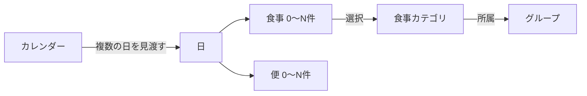
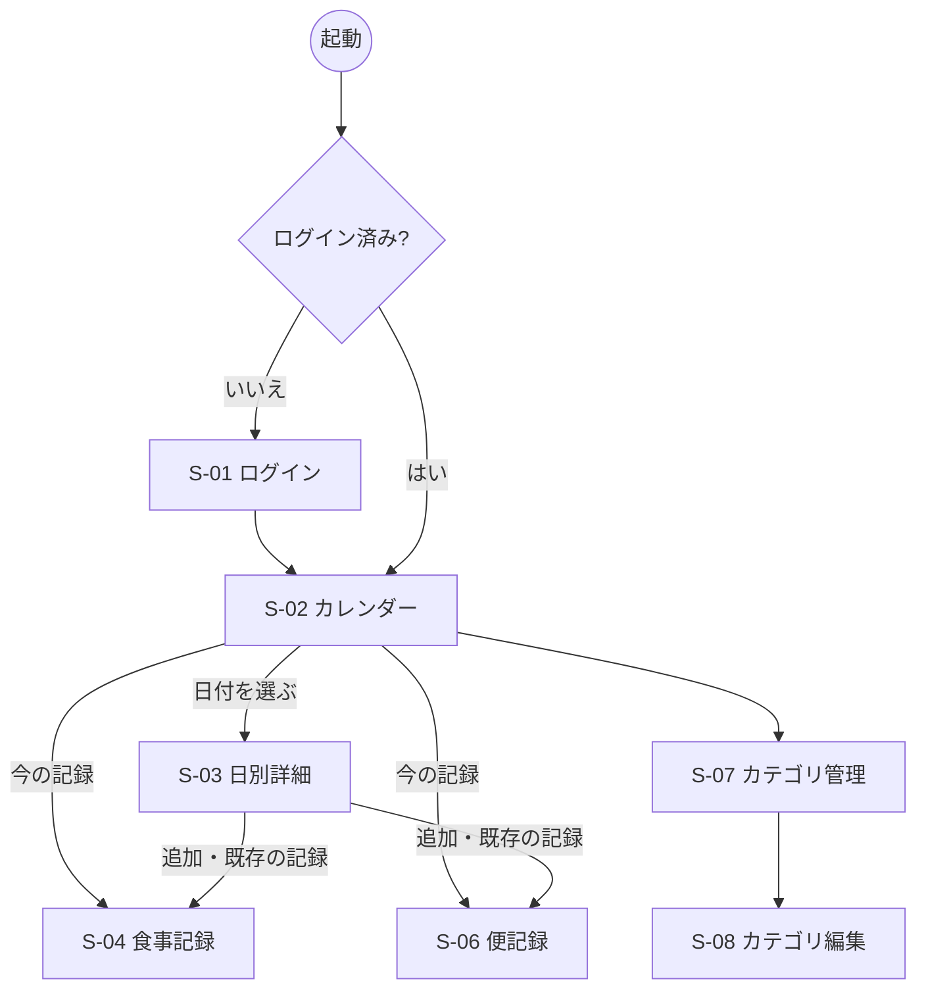

# Structure：食事・排便記録Webアプリ

> Garrett「UXの5段階」の Structure レイヤー（情報をどう組織し、操作がどう流れるか）を定義する文書。
> 前提資料：[01-strategy.md](01-strategy.md)、[02-scope.md](02-scope.md)
> 画面内の配置や部品の選定は Skeleton、色やアイコンの表現は Surface で扱う。
>
> - 状態：確定（2026-11-09）、間食の統合を反映（2026-11-10）
> - 記法：末尾の `→Q番号` は 9章の判断事項に対応する。`F-xx` は Scope の機能IDを指す。

---

## 1. 構造の方針

| 方針 | 内容 | 根拠 |
|---|---|---|
| 「日」を中心に組織する | すべての記録は、いずれかの日に属する | カレンダー中心の要件 |
| カレンダーを起点にする | 起動直後の画面をカレンダーとし、すべての操作をここから始める | F-04 |
| 記録は1タップで始められる | カレンダーから直接、食事と便の記録を開始できる | G1、原則1 |
| 階層を浅くする | 記録まではカレンダーの1階層下、確認と修正は最大でも2階層下に収める | 原則1、過剰につくらない |
| 記録と振り返りの経路を分ける | 今の記録はカレンダーから直接、確認と過去分の追加は日別詳細から行う | 原則4 |

---

## 2. 概念モデル

- **日**：振り返りの単位。端末の暦日（0時）で区切る。
- **記録**：食事と便の2種類。利用者が作成、編集、削除する対象。
- **食事枠**：朝食、昼食、夕食は1日に各1件。その他の食事は1日に何件でも作れ、間食もここに記録する。
- **カテゴリ**：記録の選択肢。「使わない」状態にしても過去の記録には残る。

---

## 3. 情報の組織化

### 日別詳細の並び

時刻より記録の種類を優先し、常に同じ位置で探せるようにする。

1. 朝食
2. 昼食
3. 夕食
4. その他の食事（作成順）
5. 便（時刻順）

朝食・昼食・夕食は、記録がなくても常に枠として示す。

### カテゴリの並び

Scope の初期カテゴリの順序で固定する。使用頻度による自動並び替えは行わず、位置を覚えて素早く選べるようにする。

| 種別 | 構成 |
|---|---|
| 食事カテゴリ | 主食 → 肉・魚・卵 → 野菜・果物 → その他 → お菓子 の5グループ |
| 追加したカテゴリ | 所属するグループの末尾 |

### 週カレンダーの1日分の情報

| 順序 | 情報 | まとめ方 |
|---|---|---|
| 1 | 日付、今日かどうか | |
| 2 | 便 | 排便1回につき1つ、形状がわかる形で示す（回数がわかる） →Q22 |
| 3 | 食事カテゴリ | その日に食べたカテゴリを、重複を除いて1回ずつ示す。どの枠で食べたかは日別詳細で確認する。お菓子もグループの一つとして同じ並びで示す →Q22 |

### 月カレンダーの1日分の情報

日付、今日かどうか、便（排便1回につき1つ、形状がわかる形）のみを示す。

---

## 4. 画面一覧

| ID | 画面 | 役割 | 機能 |
|---|---|---|---|
| S-01 | ログイン | 本人であることを確認する | F-07 |
| S-02 | カレンダー | 起点。週・月の表示切替、記録の開始 | F-04, F-10 |
| S-03 | 日別詳細 | 1日分の確認、その日への記録の追加 | F-05 |
| S-04 | 食事記録 | 食事の新規作成、編集、削除、前回のコピー | F-01, F-06, F-09 |
| S-06 | 便記録 | 便の新規作成、編集、削除 | F-03, F-06 |
| S-07 | カテゴリ管理 | カテゴリの一覧と追加 | F-11 |
| S-08 | カテゴリ編集 | 名称、所属グループ、「使わない」の変更 | F-11 |

F-08（スマホ向けPWA）は全画面に共通する前提であり、専用の画面はない。S-05（間食記録）は S-04 に統合したため欠番とする。

---

## 5. 画面遷移

### 戻り先のルール

| 操作 | 戻り先 |
|---|---|
| S-04、S-06 で保存、キャンセル | 開始した画面（S-02 または S-03） |
| S-04、S-06 で削除 | 開始した画面。編集は通常 S-03 から開くため、S-03 に戻る（2026-11-10 変更。履歴に同じ画面が重ならないようにするため） |
| S-03 から戻る | S-02（表示していた週・月と期間を保持） |
| S-08 で保存、キャンセル | S-07 |
| S-07 から戻る | S-02 |

S-02 を開いたときは、今日を含む週を週表示で示す。

---

## 6. 主要な操作フロー

タップ数はアプリを開いた状態から保存までの回数。

| タスク | 手順 | タップ数 |
|---|---|---|
| 便を記録 | 便 → 形状を選ぶ → 保存 | 3（量や排便感を入れる場合は各+1）→Q17 |
| 間食を記録 | 食事 → その他の食事 → カテゴリを選ぶ → 保存 | 4（カテゴリの追加ごとに+1） |
| 食事を記録 | 食事 → カテゴリをN個選ぶ → 保存 | 2+N（枠が推定と異なる場合は+1）→Q18 |
| 前回と同じ食事を記録 | 食事 → 前回をコピー → 保存 | 3 |
| 記録し忘れを追加 | 日付を選ぶ → 種類を選ぶ → 入力 → 保存 | 上記の各タスク+1 |
| 記録を修正、削除 | 日付を選ぶ → 記録を選ぶ → 修正または削除 | 2+操作分 |
| 週の傾向を見る | カレンダーを見る | 0 |

週や月が異なる日の操作は、表示の移動分のタップが加わる。

---

## 7. 画面ごとの振る舞い

### 記録画面の共通ルール

| 項目 | 振る舞い |
|---|---|
| 対象の日 | S-02 から開くと今日、S-03 から開くとその日。画面上で対象の日がわかるようにする |
| 保存の条件 | 必須項目が揃うまで保存できない |
| 保存後 | 戻り先の画面に、保存したことを短く知らせる。カレンダーと日別詳細にはすぐ反映する |
| キャンセル | 確認なしで入力を破棄する →Q21 |
| 削除 | 編集時のみ実行できる。確認を経て削除する |
| 未来の日 | 記録の対象にできない。カレンダーでは表示するが、選択できない →Q19 |
| 「使わない」カテゴリ | 新規の選択肢には出ない。そのカテゴリを含む過去の記録を編集するときは選択済みで表示し、外すこともできる。一度外すと選び直せない |

### S-04 食事記録

状態は「選択中の枠」によって決まる。

| 開き方 | 枠の状態 |
|---|---|
| S-02 の「食事」 | 現在時刻から枠を自動で選ぶ（0:00〜10:59 朝食、11:00〜15:59 昼食、16:00〜23:59 夕食）。変更できる →Q18 |
| S-03 の記録がない枠 | その枠を選択した状態で開く。変更できる |
| S-03 の「その他の食事を追加」 | その他の食事を選択した状態で開く |
| S-03 の既存の記録 | その記録の編集。枠と日付は変更できず、誤りは削除して再入力する →Q20 |

新規作成中に枠を切り替えたときの動きは、次のとおりとする。

| 切替先 | 動き |
|---|---|
| その日に記録がない枠 | 新規作成のまま。選択中のカテゴリを引き継ぐ |
| その日に記録がある朝食・昼食・夕食 | その記録の編集に切り替わり、既存の内容を表示する（Q11） |
| その他の食事 | 新規作成のまま。選択中のカテゴリを引き継ぐ |

**前回のコピー**は、朝食・昼食・夕食の新規作成時のみ使える。

- 対象は、対象の日より前で最も新しい同じ枠の記録とする。
- 実行すると、選択中のカテゴリを前回の内容に置き換える。保存するまでは記録されず、自由に変更できる。
- 「使わない」カテゴリはコピーしない。
- 前回の記録がない場合は使えない。

### S-06 便記録

| 項目 | 振る舞い |
|---|---|
| 新規の時刻（今日） | 保存時の時刻を自動で記録する。時刻の入力は求めない |
| 新規の時刻（過去の日） | 日付はその日、時刻は操作時の時分を初期値にする |
| 編集時 | 日付と時刻を修正できる（Q5） |
| 便の必須項目 | 形状のみ。量と排便感は同じ画面で任意に選べ、選択の解除もできる |

### S-02 カレンダー

| 項目 | 振る舞い |
|---|---|
| 表示切替 | 週と月を切り替える。切り替え時は、表示中の期間を含む週または月を示す |
| 期間の移動 | 前後の週または月に移動できる。今日を含む期間へ戻れる |
| 記録の開始 | 食事と便の開始操作を週・月のどちらの表示でも常に使える |
| カテゴリ管理 | 頻度が低いため、記録の開始操作より目立たない経路にする |

### S-07 カテゴリ管理・S-08 カテゴリ編集

| 項目 | 振る舞い |
|---|---|
| 一覧の構成 | グループごとに示す。「使わない」カテゴリは使用中のものと区別する |
| 追加の入力 | 名称と所属グループ |
| 編集の入力 | 名称、所属グループ、使う／使わない |
| 入力の制約 | 空の名称と、同じグループ内での重複した名称は保存できない |
| 注意の表示 | 名称の変更は過去の記録にも反映されることを、編集時に示す |

---

## 8. 共通の状態とラベル

### システムの状態

| 状態 | 振る舞い |
|---|---|
| 読み込み中 | 読み込み中であることがわかるようにする |
| カレンダー、日別詳細の読み込み失敗 | 再試行できるようにする |
| 保存の失敗 | 記録画面に留まり、入力内容を保持したまま再試行できるようにする |
| 通信中の保存操作 | 二重に保存されないようにする |
| オフライン | 通信できず保存できないことを伝える（Q14） |
| ログインの期限切れ | S-01 を表示し、ログイン後は S-02 に戻る |

### 記録がないときの表現

記録の抜けと「該当なし」を区別しない（Q4）ため、「食べていない」「排便なし」のように断定せず、「未記録」と示す。

### ラベル

| 対象 | ラベル | 備考 |
|---|---|---|
| 記録の種類 | 食事、便 | |
| 食事枠 | 朝食、昼食、夕食、その他の食事 | |
| カレンダーの表示 | 週、月 | |
| カテゴリを選択肢から外す状態 | 使わない | 「削除」とは呼ばない |
| コピーの操作 | 前回をコピー | 枠の名前は選択中の枠でわかる |
| お菓子の「その他」 | グループ内では「その他」、日別詳細では「お菓子：その他」 | グループ名の「その他」と区別するため |

便の状態に「良い」「悪い」という評価のラベルは付けない。

---

## 9. 判断事項

すべて 2026-11-09 に確定済み。

| # | 問い | 決定 | 理由 |
|---|---|---|---|
| Q17 | 便は形状を選んだ瞬間に保存するか | しない。形状 → 保存 の順で、計3タップとする | 即時保存は2タップで済むが、同じ画面で量と排便感を入れられなくなり、誤タップも直しにくい。3タップでも目安の約5秒に収まる見込み |
| Q18 | 食事枠の初期値を現在時刻から自動で選ぶか | 選ぶ。時間帯は 0:00〜10:59 朝食、11:00〜15:59 昼食、16:00〜23:59 夕食とする | 枠を選ぶ1タップを多くの場合で省ける。外れても1タップで直せる |
| Q19 | 未来の日に記録できるか | できない | 記録は実績のみを扱い、誤操作も防げる |
| Q20 | 既存の食事の日付や枠を編集で変更できるか | できない。誤りは削除して再入力する | 食事の記録は数タップで作り直せる。変更を許すと、枠が重複したときの処理が必要になる |
| Q21 | キャンセル時に、入力の破棄を確認するか | しない | 入力量が少なく、再入力の負担より確認の手間のほうが頻繁に発生する |
| Q22 | 週カレンダーの1日分をどうまとめるか | カテゴリは日単位で重複を除く。便は回数分示す。お菓子はグループの一つとして同じ並びで示す | 週の傾向は「その日に何を食べたか」でわかる。便は回数も傾向の一部（Strategy のニーズ3） |

---

## 10. 次のステップ

1. Skeleton レイヤー（画面の配置、部品、週カレンダーの表示方法）の定義に進む（[04-skeleton.md](04-skeleton.md)）
