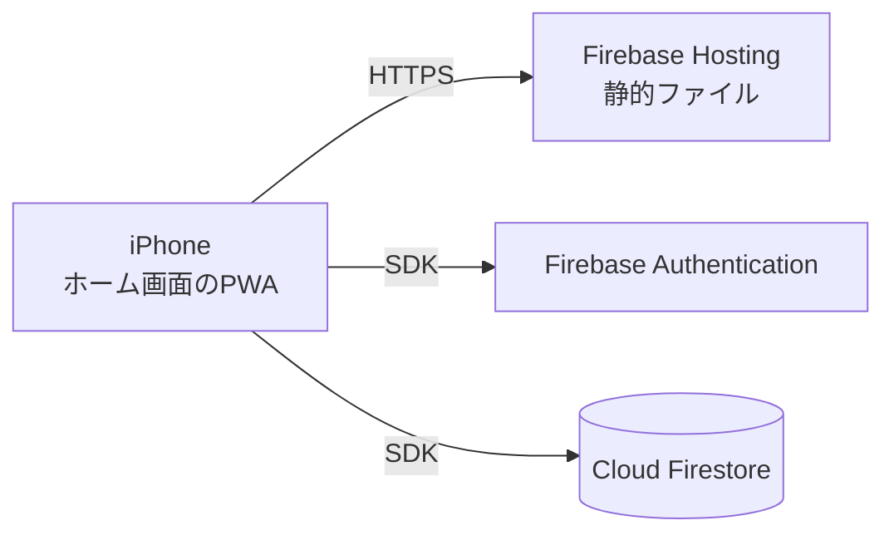

# 技術選定：食事・排便記録Webアプリ

> UX5レイヤー（[01](01-strategy.md)〜[05](05-surface.md)）の決定を、実装の技術に落とし込む文書。
>
> - 状態：確定（2026-11-10）
> - 記法：末尾の `→Q番号` は 8章の判断事項に対応する。
> - 無料枠の条件は 2026-11-10 に各サービスの公式ページで確認した。条件は変わることがあるため、利用開始時に再確認する。

---

## 1. 選定の前提

前提資料から導かれる条件。

| # | 条件 | 出典 |
|---|---|---|
| C1 | 無料で運用できる。支払い方法の登録も避けたい | Strategy Q1 |
| C2 | 本人以外がデータにアクセスできない | Scope F-07 |
| C3 | 一度ログインすれば、普段はログインを求めない | Scope F-07 |
| C4 | スマホのホーム画面に追加できる PWA。HTTPS で配信する | Scope F-08 |
| C5 | 「揚げ物を食べた日の数を月ごとに集計」できるデータ構造 | Strategy G3 |
| C6 | しばらく使わなかった後でも、そのまま記録を再開できる | Strategy G1 |
| C7 | 過剰につくらない。個人で保守できる | Strategy 設計原則 |
| C8 | 将来、オフライン記録に対応する余地がある | Scope Q14 |

データ量は1日あたり5件前後、1年で約2,000件と見込む。どのサービスでも無料枠の容量や回数が問題になる規模ではない。

---

## 2. バックエンドの比較

| 観点 | Firebase（Firestore＋Authentication） | Supabase（PostgreSQL＋Auth） |
|---|---|---|
| 無料枠の容量 | 1 GiB、読み取り 5万回／日、書き込み 2万回／日 | 500 MB、2プロジェクトまで |
| 支払い方法の登録 | 不要と明記 | 公式ページに記載なし |
| 使わない期間の扱い | 停止の規定なし | **7日間活動がないと一時停止**。管理画面から手動で再開する必要がある（停止から1年以内） |
| 本人のみのアクセス | セキュリティルールで利用者IDごとに制限 | 行レベルセキュリティで制限 |
| 月ごとの集計（C5） | 月の記録を取得して画面側で数える（1か月で約150件） | SQL で直接集計できる |
| オフライン対応の余地（C8） | SDK にオフライン書き込みの仕組みがある | 自前で作る必要がある |
| 静的ホスティング | 同じプロジェクト内で提供（Firebase Hosting） | 別のサービスが必要 |

### 判断

**Firebase を採用する。** →Q34

- 決め手は C6。Supabase は旅行や体調不良で7日間記録しなかっただけで停止し、再開時にアプリが動かない。記録の再開が最も途切れやすい場面で摩擦が生じる。
- Supabase の強みは SQL での集計だが、データ量が小さいため、Firestore でも画面側で十分に集計できる。
- ホスティング、認証、データベースが1つのプロジェクトで完結し、管理の手間が少ない（C7）。

---

## 3. 技術構成

サーバー側のプログラムは持たない。画面から Firebase の SDK で直接データを読み書きし、アクセスの制限はセキュリティルールで行う。

| 層 | 採用 | 理由 |
|---|---|---|
| 言語 | TypeScript | データの形の誤りを書く段階で防げる |
| ビルド | Vite | 設定が少なく、開発時の反映が速い |
| UI | React →Q35 | 情報と事例が多く、8画面規模の状態管理を素直に書ける |
| 画面遷移 | React Router（データルーター） | URL と画面を対応させ、ブラウザの戻る操作に対応する。遷移の動きは View Transitions API で付ける（[src/hooks/useNav.ts](../src/hooks/useNav.ts)） |
| 書体 | Google Fonts（Bodoni Moda、Zen Kaku Gothic Antique） | Surface 第2版の数字と印に使う。Service Worker で端末に保持する |
| デザイン確認 | デモモード（`npm run demo`） | `src/data/*` を `src/demo/*` のメモリ内実装に差し替え、Firebase なしで全画面を例データで表示する。本番ビルドには含まれない |
| スタイル | 素の CSS（CSS変数、1ファイルの `global.css`） | Surface の配色と寸法をそのまま変数にできる。UIライブラリは使わない。実装時に CSS Modules は使わず、クラス名の接頭辞で画面ごとに分けた（規模が小さく、1ファイルのほうが見通しがよい） |
| PWA | vite-plugin-pwa | マニフェストと、画面のファイルをキャッシュする Service Worker を生成する |
| 日付処理 | date-fns | 週の開始（月曜）、月の範囲などの計算を確実にする |
| テスト | Vitest | 日付の計算、集計、食事枠の推定などの単純な関数に限って書く |
| 認証 | メールアドレスとパスワード →Q36 | 端末のパスワード管理機能と相性がよい |
| 実行環境 | Node.js 24（インストール済み） | |
| 構成管理 | Git（GitHub の非公開リポジトリ） →Q37 | |

このフォルダは MAMP の公開フォルダ内にあるが、MAMP（PHP、MySQL）は使わない。開発中は Vite の開発サーバーで確認する。

---

## 4. データ構造（Firestore）

すべてのデータを利用者ごとの領域 `users/{uid}/` の下に置く。

### categories（カテゴリ）

| 項目 | 型 | 内容 |
|---|---|---|
| name | 文字列 | 名称（10文字以内） |
| abbr | 文字列 | 略称（1文字） |
| group | 文字列 | `staple`／`protein`／`vegetable`／`other`／`sweets` |
| active | 真偽値 | 使う／使わない |
| order | 数値 | グループ内の並び順。追加時は末尾 |

- グループは5種で固定し（Scope Q15）、プログラム内の定数とする。
- 初回ログイン時にカテゴリが空なら、初期の26種を作成する。

### meals（食事）

| 項目 | 型 | 内容 |
|---|---|---|
| date | 文字列 | `2026-11-10` 形式の暦日（端末の時刻基準） |
| slot | 文字列 | `breakfast`／`lunch`／`dinner`／`other` |
| categoryIds | 配列 | 選んだカテゴリのID。1つ以上 |
| createdAt | 日時 | 作成日時。自動 |
| updatedAt | 日時 | 更新日時。自動 |

- 朝食・昼食・夕食の文書IDは `2026-11-10_breakfast` のように日付と枠から決める。これにより「1日に各1件」（Scope Q11）がデータ上でも守られる。その他の食事は自動IDとする。
- カテゴリはIDで参照するため、名称を変えると過去の記録にも反映される（Scope Q7）。

### stools（便）

| 項目 | 型 | 内容 |
|---|---|---|
| date | 文字列 | 暦日 |
| occurredAt | 日時 | 排便の日時。新規時は自動、編集で修正可 |
| shape | 文字列 | `hard`／`normal`／`soft`／`diarrhea` |
| amount | 文字列 または なし | `small`／`normal`／`large` |
| feeling | 文字列 または なし | `clear`／`residual` |
| createdAt、updatedAt | 日時 | 自動 |

ブリストルスケールへの拡張時は、項目 `bristol`（1〜7）を追加し、既存の `shape` は残す。

### 主な読み出し

| 用途 | 方法 |
|---|---|
| 週・月カレンダー | 期間内の `meals` と `stools` を日付の範囲で取得する |
| 前回のコピー | 同じ枠で、対象の日より前の最新の1件を取得する |
| 揚げ物の月別集計（将来） | 月の範囲で、揚げ物のIDを含む `meals` を取得し、日付の種類を数える |

週表示1回あたりの読み取りは数十件で、無料枠（5万回／日）に対して十分小さい。

---

## 5. セキュリティとログイン

| 項目 | 方針 |
|---|---|
| アクセス制限 | セキュリティルールで、`users/{uid}/` 以下はその uid でログインした本人だけが読み書きできるようにする。加えて、許可する uid を本人の1つに限定する |
| 新規登録 | 本人のアカウントは Firebase の管理画面で作成する。アプリには登録画面を設けない。加えて、Authentication の設定で「作成（登録）」を無効にし、SDK 経由の登録も止める |
| ログインの維持 | SDK の既定の保存方式で、ログイン状態を端末に保持する |
| 通信 | Firebase Hosting と SDK はすべて HTTPS |

ホーム画面に追加した Web アプリでも、長期間の未使用や端末の容量不足でログイン状態が消えることがある。その場合は再ログインで復帰でき、データは失われない。

---

## 6. オフラインの扱い

Scope Q14 により、MVP ではオフラインでの記録に対応しない。

- Service Worker で画面のファイルをキャッシュし、電波がなくてもアプリ自体は起動する。
- 保存時に通信できない場合は「通信できないため保存できません」と表示する。Firestore の SDK は通信できないと保存を待ち続ける性質があるため、通信状態の確認と待ち時間の上限で失敗を判定する。
- 将来オフライン記録に対応するときは、Firestore のオフライン保存機能を有効にする方向で検討する。

---

## 7. 無料枠に関するリスク

| リスク | 対応 |
|---|---|
| 無料枠の条件が変わる | Strategy で受容済み。利用開始時と年に1回程度、条件を確認する |
| 誤って有料プランに切り替える | 支払い方法を登録しない。有料プラン（Blaze）にしない |
| 他人に読み書きの回数を消費される | 新規登録を設けず、セキュリティルールで本人以外を拒否する |

---

## 8. 判断事項

すべて 2026-11-10 に確定済み。

| # | 問い | 決定 | 理由 |
|---|---|---|---|
| Q34 | どのクラウドサービスを使うか | Firebase（Firestore、Authentication、Hosting） | 使わない期間による停止がなく、支払い方法の登録が不要。1つのプロジェクトで完結する |
| Q35 | 画面をどの仕組みで作るか | React＋TypeScript＋Vite | 情報が多く、規模に対して十分に単純。慣れた技術があれば、そちらを優先する |
| Q36 | ログイン方式 | メールアドレスとパスワード | 本人1名のみで、パスワード管理機能で入力を省ける。Googleアカウントでのログインに比べ、ホーム画面のアプリでの動作が安定している |
| Q37 | ソースコードの管理 | Git を使い、GitHub の非公開（Private）リポジトリで管理する。Firebase の設定値は `.env.local` に置き、リポジトリに含めない（2026-11-10 変更） | 変更の履歴を残し、Claude Code on the web から作業できるようにする。記録データは Firestore にあるため、リポジトリには入らない |

---

## 9. 次のステップ

1. Firebase のプロジェクトを作成する（2026-11-10 作成済み。Firestore は `asia-northeast2`、本番モード）
2. ワイヤーフレーム（[wireframes.html](wireframes.html)）で画面設計を視覚的に確認する（済み）
3. 実装（2026-11-10 MVP の初版を作成。手順は [README.md](../README.md)）
4. Firebase 側の残り作業：本人アカウントの追加、登録の無効化、`firebase deploy --only firestore` でルールとインデックスを反映、Hosting へ公開
5. 実機（iPhone）でホーム画面に追加し、週カレンダーの視認性と記録の入力速度（便 約5秒、食事 約15秒）を確認する

---

## 参考

- [Firebase の料金](https://firebase.google.com/pricing)
- [Supabase の料金](https://supabase.com/pricing)
- [Supabase：Project Pausing](https://supabase.com/docs/guides/platform/free-project-pausing)
